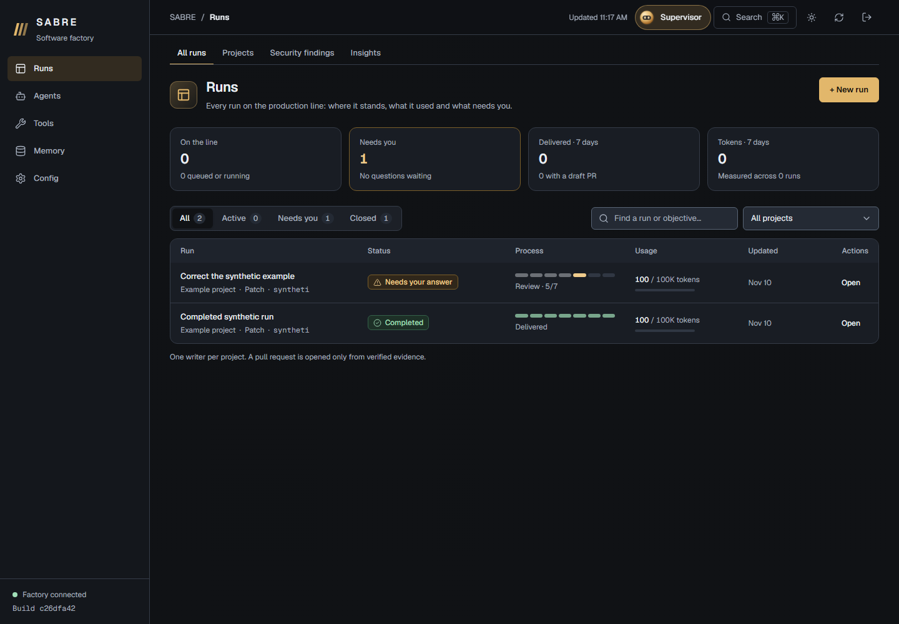
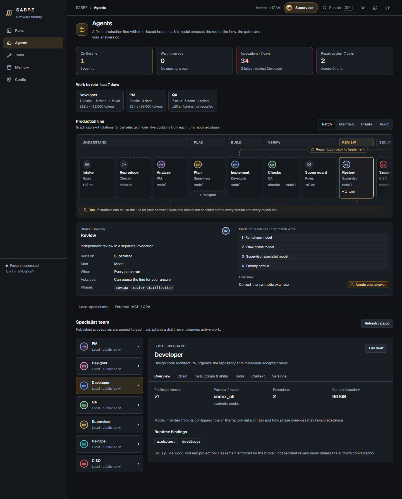

# SABRE Factory

A local software factory for Python and JavaScript/TypeScript projects. Define an outcome, choose models by phase, and follow the work through checks, independent review and a draft pull request.

SABRE runs on your machine with your credentials. LangGraph owns recoverable execution; the panel, MCP tools and Slack use the same application service. Merge and deployment remain separate decisions.

## Status

Experimental and unreleased. What is tested is the control plane: durable and resumable runs, budgets with reserves, the command sandbox, security gates, owner confirmations, and the console, which a browser suite exercises against the real API. What is not proven is the work itself: no run with a real model has delivered a pull request, and the GitHub connection has only met a synthetic GitHub. Only Windows with Docker Desktop has been exercised. [The roadmap](docs/roadmap.md) lists every gap and the bar for a public release, and [the threat model](docs/threat-model.md) says what is defended and what is not.

## Console

The console rendered with example data from its browser fixtures. Run outcomes and usage shown here are synthetic, not live-model delivery results.



<details>
<summary>Agents and the production line</summary>



</details>

## Start

Use the complete source checkout or the source archive attached to a GitHub release. The Python wheel contains only the backend: it has no `sabre` command, panel, Compose services or bootstrap provisioning. `pip install sabre-factory` is not an installation of the product, and PyPI is not a distribution target for this first version.

Install Node.js 24 or later and a local Linux Docker engine with Compose. Use Docker Desktop on Windows or macOS, or Docker Engine on Linux. No dedicated WSL distribution or host Python installation is required. Host web development checks additionally require the Node.js and pnpm versions declared in `web/package.json` (CI uses Node.js 24.22.2 and pnpm 11.19.0).

Clone and enter the repository, or extract the release archive into an empty directory and enter it. While the repository is private, cloning requires access.

```sh
git clone https://github.com/Altitud-Studio-S-L-U/sabre-factory.git
cd sabre-factory
```

```sh
node bin/sabre.mjs doctor
node bin/sabre.mjs init
node bin/sabre.mjs config
node bin/sabre.mjs build all
node bin/sabre.mjs prepare
node bin/sabre.mjs up
```

`up` opens the panel in your default browser, already signed in, on Windows, macOS and Linux. The browser stays paired while you use it and signs out after 30 days without use. To pair another browser, or after signing out, run `node bin/sabre.mjs open`. Use `up --no-open` on machines without a desktop. Run `npm link` once in this directory to use `sabre <command>` instead of `node bin/sabre.mjs <command>`. No link or token is displayed, and the panel never receives the permanent control credential.

`init` creates protected, service-specific bootstrap files and a master key in Docker volumes. The ignored `.env` contains public configuration. API keys entered in the write-only panel are encrypted in a separate PostgreSQL vault. Coding and verification containers receive no integration credentials.

To check the harness without an account or provider charges, run the included Python example:

```sh
node bin/sabre.mjs bench --task patch-discount
```

Expect `1/1 tasks passed (reference_policy; tokens estimated_utf8_bytes_div_4)`. This drives the real graph over `backend/bench/repos/pricing`, validates discount bounds and runs the project's `python -m unittest` checks plus a separate regression grader. The model, executor and publisher are test implementations; it does not exercise deployed containers or deliver a real GitHub pull request. The report is saved under `work/bench/`. [Operations](docs/operations.md#verification) gives the separate runtime and recovery checks.

Connect a model in Config › Models. An API provider (OpenAI, Anthropic, Google, or a local OpenAI-compatible endpoint) is the path this guide assumes: its key is entered in the write-only panel and stored encrypted. A Codex or Claude CLI session (`codex-login`, `claude-login`) is an alternative for your own machine only: it signs the vendor's CLI in with your personal account inside an isolated runner, and it is not meant for anything you share or run for others. Whether your plan allows that use is for you to check with the vendor; the factory cannot. Choose the factory default in Config and explicit role overrides in Agents; external connections are managed in Tools. Select explicit model names, approved destinations, prices and limits. Add a repository in Runs › Projects › Add project (from GitHub, by address or as a new repository) with its real verification commands, then launch a flow. See [operations](docs/operations.md) for login, isolation, backup and recovery.

Python projects run on Python 3.14. Their `uv.lock` or hashed `requirements.txt` must provide compatible wheels for the runner's architecture; dependency preparation disables builds from source and project installation scripts. A project that only supports an earlier Python, or locks a dependency without a Python 3.14 wheel, can stop at intake before any model call. Verification commands must work against the source checkout without building/installing the project itself.

The Supervisor conversation is available throughout the authenticated panel and through owner MCP tools. Messages are durable and read-only by default. Grant individual action tools per message when you want the Supervisor to act; run-scoped conversations cannot modify another run. Replies use the control worker independently of execution. Each new message pins its published Supervisor definition. Conversation, run coordination and independent judging retain separate contexts. A blocked message retains its checkpoint and can be explicitly reconciled and resumed.

Agents provides seven versioned specialists, with revision-checked drafts, validation and publication. Runs pin published instructions, registered procedures, skills and tool restrictions. Publishing a later version affects future launches. Tools also manages separately authenticated delegated clients and reviewed external-agent connections; external metadata and instructions cannot grant owner authority. See [configuration](docs/configuration.md) for these contracts and [implementation specs](docs/specs/README.md) for the agreed scope.

## Flows

| Flow | Outcome |
| --- | --- |
| `patch` | Baseline verification, scoped plan, regression fix, independent checks and draft PR |
| `maintain` | Analysis, dependency-ordered tasks, implementation, checks and draft PR |
| `create` | Requirements and architecture, implementation, checks and draft PR |
| `audit` | Checks and an evidence report; project changes block completion |

Flows use code-defined transitions. YAML selects registered models and skills; it cannot execute code or grant new tool permissions. Each run retains its resolved configuration and skill digests. Verification failures block publication. Budgets default to 40 invocations, 100,000 tokens, one hour and two repairs. Each metric can instead have an explicitly authorized finite reserve or no cumulative ceiling; paid API spend remains separately bounded. Repeated identical failed evidence requires intervention even with uncapped repairs. Unknown consumption remains unknown, and CLI token consumption may only be measured after an invocation.

[Flow configuration and integrations](docs/configuration.md) describe per-phase precedence, skills, Slack and signed webhooks. The panel shows measured phase, agent and tool events. Unknown measurements remain unknown. Browser tests use synthetic responses and are not evidence of a live provider run.

## Components

- `backend/`: FastAPI, Pydantic contracts, LangGraph/LangChain, PostgreSQL, Procrastinate and OpenTelemetry.
- `web/`: React/TypeScript panel; API types generated from the backend OpenAPI contract.
- `infra/` and `bin/`: pinned images, isolated runners and the common Node launcher.

[Architecture](docs/architecture.md) describes state ownership and trust boundaries. [Credential storage](docs/credential-storage.md) describes encryption and revocation.

## Verification

```sh
node --test infra/*.test.mjs
node bin/sabre.mjs bench
node infra/dev.mjs test
node infra/dev.mjs lint
node infra/dev.mjs types
pnpm --dir web install --frozen-lockfile
pnpm --dir web typecheck
pnpm --dir web lint
pnpm --dir web test
pnpm --dir web exec playwright install chromium
pnpm --dir web test:browser
pnpm --dir web build
node bin/sabre.mjs build api && node infra/qa.mjs up && node infra/qa.mjs check; node infra/qa.mjs down
```

Backend checks run in pinned containers. `pnpm test:browser` answers every request from a mock; `node infra/qa.mjs check` runs the console against the real API and a real PostgreSQL on an isolated fixture, without a model provider. PostgreSQL integration and recovery checks require the isolated development network; see the operations guide. Dependency updates retain a seven-day release-age policy. Required checks must pass against the exact candidate commit.

The target host matrix is Windows 11 x64, Linux x64/arm64, and macOS Intel/Apple Silicon. These are validation targets, not a claim of support. Windows with Docker Desktop has local evidence; full installation, real-provider execution, restart and restore on Linux x64, Linux arm64, macOS Intel and macOS Apple Silicon remain pending. Images target Linux amd64/arm64. An image build, Linux container on Windows or launcher test alone does not establish full host compatibility. A public release requires installation, execution, restart and restore evidence on every advertised host; that validation is not yet complete.

## License and inspiration

MIT. See [LICENSE](LICENSE) and [NOTICE](NOTICE). The visual separation of deterministic stages, agent work and human intervention is inspired by [super-simple-software-factory](https://github.com/disler/super-simple-software-factory). SABRE retains its own persistent runtime, tool broker and publication checks.
