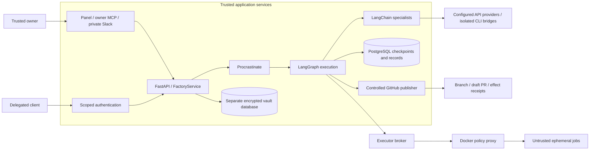

# Architecture

SABRE is a single-owner application on a local Docker Compose host. It coordinates Python and JavaScript/TypeScript work in one repository per project. Two simultaneous executions are allowed by default (configurable up to sixteen), with one writer per repository. The intended development output is a checked branch and draft PR; [compatibility](compatibility.md) distinguishes implemented contracts from live-delivery evidence.

## Components and trust boundaries

Only the Docker policy proxy holds the daemon socket. It has no network and admits the broker's restricted sandbox operations. Jobs use digest-pinned images, a read-only root, no outer capabilities, no host paths/devices/published ports and scoped workspace/cache mounts. Coding and verification have no network by default. Dependency preparation and scanner updates use separate controlled proxies. Containers share the host kernel; this is not a VM boundary.

API, execution and control workers hold protected bootstrap credentials and the vault master key. The project/memory role cannot connect to the vault database. The executor and Slack gateway use fixed-purpose credential adapters without vault/master access. CLI runners have separate authentication volumes and no project, GitHub, database or Docker access. See [credential storage](credential-storage.md) and the [threat model](threat-model.md).

## Execution and state ownership

`Runtime` composes the application. `FactoryService` owns authorization and admission, `Factory` owns the versioned LangGraph topology, and provider/tool/publisher adapters enforce external boundaries.

| State | Authority |
| --- | --- |
| Workflow continuation and pending interruptions | LangGraph checkpoints, with synchronous durability |
| Work admission, configuration revisions, usage, human responses and effect receipts | PostgreSQL application tables |
| Scheduling and stalled-worker recovery | Procrastinate jobs and heartbeats |
| Timeline, notifications, metrics and inspection | Read projections of recorded execution |
| Source navigation indexes and embeddings | Rebuildable, source-scoped derived data |

Admission and queue creation share a transaction. Graph version, source snapshot and plan revision bind execution. Scope revisions invalidate earlier questions, plans and evidence. Client disconnection does not stop work. Pause/cancel apply at safe boundaries; an in-flight tool can finish.

External effects retain operation keys and receipts. A lost response requires inspecting the existing target before another write. Restoring a checkpoint does not undo provider charges or GitHub effects; exactly-once behavior is not claimed for remote systems.

## Workflow and specialists

Development proceeds through intake, analysis, necessary clarification, permission-bound architecture for create, planning, implementation, deterministic gates, QA/review, independent security and delivery or correction. Audit additionally requires unchanged source. Plans reject duplicate IDs, missing dependencies and cycles.

PM, Designer, Developer, QA, Manager (shown as Supervisor), DevOps and CISO are versioned specialists. Coordination, owner conversation and independent review use separate invocations. Runs pin published definitions, procedures, skills, models and context/tool restrictions. Instructions cannot grant authority. [Configuration](configuration.md#factory-configuration-and-specialists) describes editing and publishing.

Tasks carry acceptance criteria and bounded dependency observations. Gates run on disposable copies of the approved snapshot; QA receives actual command results. Edits compare current source digests under the workspace lock. Tools/output are bounded; recoverable argument/read/edit failures return typed observations, while authorization, secret, budget and infrastructure errors stop the stage.

Default repair count is two. Agent invocations retain a 50-step limit and ten-minute deadline; CLI calls have a two-minute deadline. Repeated identical gate/source/task outcomes trigger no-progress intervention. Increasing a budget does not establish passed verification.

## Security and authorization

Repository contents, memory, model output, tool responses, MCP manifests and remote Agent Cards are untrusted data. Code validates grants, plans, budgets, transitions and publication. Owner MCP files sensitive decisions for confirmation in a paired browser. Delegated MCP/A2A clients have expiring project/operation/budget grants; prompt content cannot make them the owner.

The independent security graph collects Gitleaks, Trivy and Semgrep evidence bound to source/rule digests. Missing, failed or incomplete scans block assessment. Secrets remain blocking. Eligible high/critical findings require an expiring owner exception bound to finding, source, plan and rules; publication rechecks it. Daily monitoring proposes remediation without launching development.

Browser QA uses a disposable preview and separate unprivileged Playwright/axe job on a per-job internal network. The browser receives no source or credential mount. Receipts bind viewport, evaluator and exact snapshot. Trace archives remain quarantined pending secret inspection/redaction. Shipped models cannot inspect images; automation does not prove subjective visual quality or full accessibility compliance.

## Context and memory

Full history stays in LangGraph checkpoints. Invocation-local projection replaces older internal reads, command output and answered write content with guarded references. Recovery reads exact archived bytes through a bounded tool authorized from that child's recorded calls. Current edits still require a current digest; recovered history does not establish source freshness.

Projection batches archive from a high-water mark to a low-water mark. If necessary, successful old read-only turns can leave the model-facing view; effectful turns, errors and human decisions remain protected. Irreducibly oversized requests stop before a model reservation. Context receipts record digests, bytes and coverage without another prompt log. Byte reduction alone does not demonstrate token savings or provider-cache reuse.

Project memory is separate from checkpoints and working notes. Repository reads and specialists propose cited records; only owner approval activates them. Commit-scoped records apply at their commit. Project-scoped records require unchanged cited file digests at later indexed commits; changed/deleted/renamed citations become stale. Retrieval rechecks project, activity, invalidation and digest, and can block with `MEMORY_CONTEXT_CHANGED`. No eligible memory means no embedding call. PostgreSQL/pgvector and bounded relational links provide storage; no separate graph database is deployed.

## Interfaces and observability

Strict contracts in `contracts`, `flow_contracts`, `agent_contracts`, `phase_results`, `commands` and `events` reject extra fields and invalid versions. REST, MCP, Slack and A2A share application authority. Command receipts deduplicate completed effects; uncertain controls require inspection.

External MCP tools are explicitly reviewed, digest-bound and currently read-only. Outbound A2A connections bind reviewed destinations/contracts and remote task receipts; unknown effects/costs stay unknown. Webhooks and Slack use outboxes and reconciliation separate from workflow state. See [configuration](configuration.md).

Events and usage feed the console, metrics and OpenTelemetry. Allowlisted identifiers, timings, counts and codes are exported; prompts, source, arguments, outputs, credentials and raw exceptions are excluded. Missing measurements remain unknown. Functional evaluation requires independent revision/commit-linked annotations. See [observability](observability.md).

The React panel uses Tailwind tokens and locally owned shadcn primitives. Modules under `web/src/features/` own runs, projects, specialists, security and the Supervisor; API types derive from OpenAPI. UI projections do not decide graph advancement.

## Publication boundary

Draft PR delivery rechecks source, base commit, gates, review and security before writing, without force-pushing. Release preparation records an immutable candidate and does not publish. Separate owner authorization binds its digest/revision; publication rechecks exact-commit CI, artifacts, tag and remote identity, reconciling unknown responses before further effects.

GitHub tag reads and release publication are separate operations. A final tag check narrows a race but cannot prevent another authorized writer moving a mutable tag later; enforce protected/immutable tag policy when required. A receipt records the verified outcome at that point. Merge and deployment are outside development commands.
