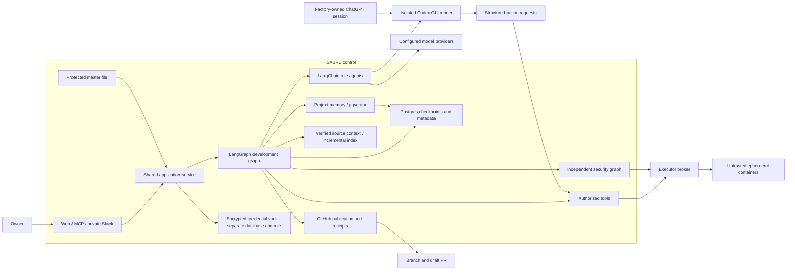
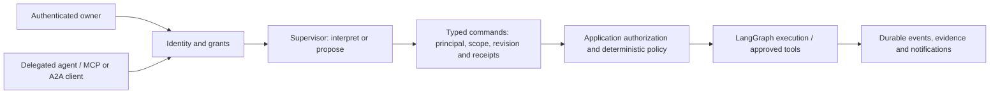

# Architecture and execution contract

## Scope

One owner, Python and JS/TS projects, two simultaneous executions by default (configurable up to sixteen) and one writer per repository. Codex and Claude CLI subscription sessions, OpenAI, Anthropic, Google and local model endpoints use explicit provider configuration. Development delivers a branch and draft PR. Immutable release candidates use separate owner authorization and publication commands; merge and deployment remain outside the available commands. Docker Compose is the deployment target; multiple nodes or a high-availability requirement would justify revisiting Kubernetes.

## Panel components

The console is styled only with Tailwind 4 utilities (no prefix, Preflight on) over the SABRE tokens in `web/src/styles/tokens.css`: semantic shadcn variables in OKLCH (graphite surfaces, gold primary, state colours with background and border pairs, timeline lanes), a 12 px minimum type scale and Geist type. `web/src/styles/index.css` is the single stylesheet entry; there are no per-screen sheets. Locally owned shadcn/ui New York primitives live in `components/ui` (button, badge, card, table, tabs, input, textarea, progress, skeleton). `web/src/components` builds the console vocabulary on them: Button (variant and size), Notice, Disclosure (native `
`, one style), Card, Table, DescriptionList, EmptyState, PageHeader and SectionHeading, CodeBlock, CheckField, Field, Select (native, styled), Dialog (native modal with busy and unsaved-change guards), Tabs (Radix, underline, scrollable), StatusBadge, UsageMeter, JsonView and LoadingState. Screens respond to the width they receive through container queries, so the docked Supervisor narrows content instead of covering it.

Feature modules group screen code: `app/` (shell, command palette, login), `features/runs` (run detail, the four-step New run wizard, timeline scale math), `features/supervisor` (presence model, avatar, dock), `features/crew` (specialist avatars), `features/projects` and `features/security`. The sidebar has five sections. Projects and Security findings are pages of the Runs area with their own addresses; `/integrations` redirects to Tools, which also holds repository creation and delivery notifications, and `/about` opens Config › About. On wide screens the Supervisor launcher sits in the header; below the lg breakpoint it floats above the tab bar. The process timeline uses a real time scale: continuous zoom anchored at the pointer (Ctrl or Cmd with the wheel, pinch, or the plus, minus and zero keys), drag to pan, a minimap of the visible window, Follow now for live runs, and an immersive workspace with a resizable inspector. Display preferences stay in memory; the console writes nothing to browser storage except the Supervisor dock width and the colour theme. Dark is the default; the header toggle and the command palette switch to light or to the system preference, and an inline script in `index.html` applies the choice before the first paint.

## State ownership

LangGraph checkpoints are the source for workflow continuation, including pending interrupts and role-agent continuation. Application tables index admitted orders, project configuration, progress projections, human responses, usage reservations and external-effect receipts. Procrastinate schedules execution; it does not implement a second order state machine.

Admission and job creation occur in one PostgreSQL transaction. Checkpoints use synchronous durability. A graph version and plan revision bind every execution. Revisions invalidate questions, plans and evidence from the previous scope. A client disconnect has no effect on execution. Pausing and cancellation are applied at safe boundaries; an already executing tool may finish first.

Owner responses are accepted transactionally only for an unanswered question in the current plan revision. Delivery effects use a durable operation key and inspect the target branch/PR before retrying an uncertain response. No claim of exactly-once execution is made for external systems.

## Development graph

Intake → analysis → clarification when necessary → architecture within launch permissions for CREATE → task plan → implementation → independent gates → technical review → independent security → correction or delivery.

PATCH reproduces and corrects a bounded defect. MAINTAIN preserves the target's stack and conventions. CREATE compares viable stack and structure choices and requires approval of architecture outside its launch permissions. The task plan is checked for duplicate identifiers, missing dependencies and cycles. Specialists receive bounded, role-specific tools and context. Reviewer and QA contexts are separated from the developer's narrative.

The task DAG covers product changes. Snapshot admission and dependency preparation precede the agents; independent QA, gates, review, security and publication follow their work. A small patch should keep its regression and fix in one coherent task unless independent work warrants splitting. The workspace has no Git metadata: agents use snapshot provenance, while the controlled publisher creates commits, branches and draft PRs. An inherited task requiring an unavailable operation must request clarification rather than claim completion.

CLI-only work can use per-agent controls instead of cumulative usage ceilings. An owner-authorized, revision-checked transition clears all three cumulative caps together while preserving recorded usage and existing checkpoints. Admission verifies CLI routing and every reservation requires a destination-bound CLI context receipt with zero API cost; API and embedding calls still require bounded authorization. LangGraph's existing 50 steps and a ten-minute deadline bound each agent invocation, alongside two correction cycles, per-tool limits and normal HITL/error/security stops. Metrics continue accumulating without being treated as completion criteria. No secondary execution engine or progress journal is introduced.

Tasks separately identify an authorization role and a technical specialty: general, backend, frontend, infrastructure or documentation. Specialization does not grant new tools. The analyst and architect inspect actual manifests, boundaries and conventions before recommending a structure. Backend/frontend/infrastructure may coexist; a registered project currently targets one repository, and related repositories require separately authorized orders. Cross-repository atomic delivery is not implemented.

Design recommendations identify the problem, alternatives, affected files and tradeoffs rather than selecting patterns by name. Documentation work maintains existing guides and canonical OpenAPI contracts, verifies examples and regenerates client types. UI work requires user-visible behavior checks and actual rendered evidence when visual acceptance is relevant. The current Codex adapter is text-only: browser test output can be assessed, but it does not provide model-based screenshot review. Missing browser or visual evidence must be reported instead of inferred from a successful build. Playwright's [testing guidance](https://playwright.dev/docs/best-practices), [OWASP ASVS](https://asvs.owasp.org/) and the [pattern selection criteria](https://learn.microsoft.com/en-us/azure/architecture/patterns/) are reference sources, not blanket compliance claims.

There are two correction cycles after an initial implementation. Scanner infrastructure failures, exhausted budgets, missing configuration and invalid authorization block explicitly. Read failures eligible for retry are bounded. A failed test is evidence for correction, never a reason to weaken the gate.

Specialist questions interrupt the graph, including planning, implementation, QA and review. Each answer is checkpointed separately. Material dependency, runtime, build and infrastructure changes require an owner permission bound to the exact selected manifests. A generic description cannot authorize a later, different change.

## Trust boundaries

The operator-console extension retains the following authority boundary:

The local stdio/MCP bridge runs with owner authority and is restricted to trusted local clients. Budget changes, security exceptions, answers to owner decisions and repository creation requested over MCP are stored as owner confirmations: they change nothing until a paired browser confirms the displayed request, which then runs the console's own operation once. The separate `/a2a` ingress accepts only expiring, revocable delegated credentials; owner bridge credentials do not authenticate there. The owner issues project, operation and finite run/budget grants. Grant issuance commits its grant and idempotency receipt atomically, storing only a bearer hash and token-free receipt metadata. The bearer appears once in the owner response; a same-key retry returns the original grant ID without the token, requiring explicit revocation and a new issuance if the owner lost that response. Typed commands retain the grant, message and namespaced command receipt; prompts, sender fields and Agent Cards cannot change the principal. Delegated answers handle clarification only, and cannot approve architecture, scope, exceptions, budget increases or publication. Worker, model and tool boundaries recheck the originating grant before effects.

The official Apache-2.0 [A2A Python SDK](https://github.com/a2aproject/a2a-python/tree/v1.3.0) is pinned to `1.3.0`, with Python 3.14 support and the A2A 1.0 JSON-RPC wire contract. Inbound discovery is local by default and grants no execution rights. Outbound Agent Cards require explicit project, role and skill selection; capability tools supplement local specialists. The public HTTPS transport pins verified public DNS addresses, retains the TLS hostname and rejects redirects, compression, destination changes and excessive responses. Card drift disables the reviewed connection. Destination-scoped vault credentials are rechecked on each send. Task/context/message receipts bind one local specialist attempt to the remote task; polling and context/history reconciliation recover lost responses without resending an uncertain effect. Cancellation and input-required states remain remote observations. Remote costs remain unknown without reliable usage evidence. SDK content tracing is disabled; SABRE's existing content-free events remain authoritative.

Browser QA is a registered capability for QA and Designer. The owner registers a synthetic preview command and port on the project; the broker executes it against the approved, dependency-prepared source snapshot in a disposable unprivileged preview. A separate unprivileged Playwright 1.64.0/Chromium and axe-core 4.11.0 job receives no source mount, credentials, Docker socket or operator profile. Only that preview and browser share an internal per-job network; no ports are published, external DNS is disabled and browser requests are restricted to the exact preview origin and port. Chromium retains its sandbox with the digest-verified policy derived from Playwright's documented profile, plus `chroot` inside its unprivileged user namespace; the outer job has no capabilities. CPU, memory, process count, operation duration, output and artifacts are bounded. Cancellation and restart recovery remove only resources labelled to the run.

Browser receipts and artifact references retain evaluator/version, viewport, run and exact snapshot. Semantic navigation, forms, clicks, keyboard/focus checks, overflow, route failures, console/page errors, screenshots, accessibility findings and traces use actual Playwright interactions. Trace archives undergo bounded secret inspection and remain quarantined from the artifact API pending inspection/redaction. Old snapshots remain historical evidence and cannot satisfy a new browser job. The shipped model adapters do not receive image input: visual model review is explicitly unavailable, and passing these checks establishes neither subjective UX quality nor accessibility compliance.

LangGraph checkpoints own execution state. Durable sequenced events feed console projections and notifications; they are not a second workflow engine. Notifications use the existing transactional outbox. Context indexes and cached read projections are rebuildable and scoped to the source snapshot/version; model output is not automatically cached or promoted to a verified fact. LangChain integrates model and tool calls; registered code validates plans, permissions, budgets, transitions and publication evidence.

Project contents, memory and tool results are data, not instructions with authority. The control process holds provider credentials. Jobs never receive them, the Docker socket or owner directory mounts. The executor broker is the only component that drives Docker, and it no longer holds the daemon socket: a `docker-proxy` service with no network holds it and admits only the broker's sandbox profile. The proxy forwards container creation only for the configured digest-pinned images, labelled as factory-owned, with a read-only root, all capabilities dropped, `no-new-privileges`, no host paths, namespaces, devices or published ports, mounting only that run's workspace volume and the two scanner caches, on no network or an internal factory network. Start, exec, logs, wait, kill, archive and removal are forwarded only for factory-labelled containers; volumes and networks only inside the factory namespace; every other Engine API operation is refused. It serves one request per connection and writes the request line, headers and checked JSON again, so the daemon parses what the policy examined. A broker defect can therefore no longer reach the API container, the database or a credential volume. Workspaces and gate environments are separate; gates are evaluated against the approved source snapshot.

The [credential storage decision](credential-storage.md) defines the separate vault database, authenticated encryption and automatic unlock. The project/memory role cannot connect to the vault. Only trusted API/worker/control processes receive its database credential and read-only master-key mount. Service-specific bootstrap files replace secret environment values. Fixed-purpose authenticated adapters supply GitHub read access to the executor and Slack tokens to the gateway; their tokens cannot access owner APIs or another adapter. Credential values are absent from OpenAPI output models, MCP tools and agent state.

Credential identifiers bind the hosted provider or canonical endpoint digest. Explicit role deactivation suppresses default fallback. Agents check the vault revision before and after model/tool calls, blocking for resume after a change. Publisher and Slack notification requests resolve current credentials at each operation. The Slack gateway rechecks credentials every ten seconds and reconnects on change; in-flight upstream requests cannot be revoked by SABRE.

All file access is confined to a work order. Secret checks run before model calls and before content enters memory, ordinary outputs or the artifact store. Supported secret detection is a control with testable coverage, not a guarantee that arbitrary sensitive text can be recognized.

Credential-URL detection recognizes the literal `user:password` placeholder only in unambiguous HTTP(S) URLs without an explicit port whose host is exactly `example.com`, `example.net` or `example.org`, the example domains reserved by [RFC 2606](https://www.rfc-editor.org/rfc/rfc2606.html#section-3). This content rule applies equally to checking and redaction; it is not a file exclusion. Different credentials, other hosts, encoded or ambiguous forms remain subject to detection. Known factory secrets and all other credential patterns are checked independently, including inside examples.

Tool schemas and role permissions are checked locally. MCP annotations supplied by external servers do not grant permissions. External servers and allowed tool names are registered by the owner, and changing servers does not implicitly expand access.

The dynamic MCP registry stores revisioned public HTTPS endpoints and approved manifest digests in PostgreSQL. Save/edit disables the connection atomically; role selection, project assignment and activation are independent commands. Active project execution holds the same lock required to change its allowlist. Dynamic connections resolve only public addresses, pin the chosen address to the transport and retain the original TLS hostname. They reject redirects, compressed responses and automatic authorization discovery. The published contract is rechecked before exposure and invocation; this detects contract drift, not a malicious remote implementation. Read-only upstream credentials remain necessary.

Each subscription CLI has a separate process, bridge and authentication volume, no project mounts and no control database, master key or GitHub access. Its result requests actions from the same SABRE catalog used by API models. Codex's pinned native policy disables shell/image tools and runs read-only. Claude exposes only its internal JSON-schema formatter, with operating tools, MCP, hooks and customization discovery disabled. It uses an empty temporary working directory and admits verified personal subscriptions only; organizational or unknown policies block invocation. The formatter returns an AssistantEnvelope, not an executable action: SABRE separately validates every requested action against its authorized catalog. Deterministic checks exercise the actual pinned binaries against synthetic providers before account connection. CLI duration, concurrency and output are bounded, but internal provider requests and aggregate tokens cannot be pre-counted exactly.

The panel and MCP use one durable model configuration with compare-and-swap revisions. Every role explicitly overrides or inherits the default; a change requires approval of the selected data destinations, preserves deployment capability restrictions and does not transfer credentials between providers. API and worker refresh this revision at existing credential boundaries. A changed revision interrupts pending sends instead of silently switching an in-flight agent. Reservation receipts bind the selected provider, configured model and configuration revision to the existing usage ledger. Their byte counts measure LangChain input material before CLI transport wrapping. CLI JSON visibly escapes DEL/C1 controls while preserving decoded content and ordinary UTF-8; it does not rewrite sources or checkpoint history. Historical missing attribution and unsettled reservations remain unknown. Model aliases identify a selection, not a resolved model version; heterogeneity is an experiment to assess, not an assumed quality improvement.

## Security graph

The independent graph collects scanner evidence, applies the owner-approved baseline and produces a blocking decision. Gitleaks handles secrets; Trivy handles dependencies and configuration; Semgrep CE handles code rules. A scanner that is missing, fails or produces an incomplete report blocks assessment. Secrets and new high/critical findings block delivery.

Findings bind the source snapshot and rules configuration. Baselines are explicit owner configuration. Expiring exceptions require an owner justification and bind one finding, work order, plan revision, snapshot and rules version. The independent graph validates them; neither scanners nor agents can supply an accepted exception id. Secrets and scanner failures remain blocking. Delivery evidence records the policy digest and exception ids; expiry or revocation invalidates pending publication.

The daily watch scans registered projects and records prioritized remediation tasks; it never launches a patch order by itself. Recommendations retain scanner references, source locations and fixed dependency versions when available.

## Memory and diagnostics

Checkpoints, project knowledge and execution lessons are distinct. Memory records belong to one project and carry their source work, commit, evidence reference, scope, optional file citations, proposer (`proposed_by`, set by the server from the console, owner MCP, supervisor chat or factory entry point), activation and invalidation state. Only facts mechanically derived from successful delivery evidence activate automatically, and they stay commit-scoped. Free-text facts and lessons require owner approval. A `commit`-scoped memory is recalled only at its source commit. A `project`-scoped memory is also recalled at a later indexed commit while every cited file keeps the content digest of its last valid commit; changed, deleted or renamed citations make it stale there, a commit without a repository index is never guessed, and the owner can carry a stale memory forward. Evaluations live in `memory_validity`, relations (`cites`, `supersedes`, `related`, `overlaps`) in `memory_links`, and every role recall or validator refusal in `memory_recalls`, all in PostgreSQL: the memory graph is a bounded relational projection, not a graph database. Embeddings are derived data.

The source index is a separate derived navigation cache keyed by project, path, content digest and index version. The current guarded snapshot controls file membership and freshness; cached metadata cannot replace source verification. Role context contains bounded references, and source tools provide literal search and line ranges with provenance. This does not automatically make a lesson valid after its source commit changes, nor does it eliminate reading changed source bytes. Context and cache measurements must precede any claim of token savings.

The analyst can pass a bounded summary and decisions to the supervisor through the same LangGraph checkpoint. This short-term handoff retains work, project, plan revision, snapshot and commit provenance; only a matching current snapshot may use it. It remains untrusted data, separate from approved project memory, with truncation and omissions reported explicitly. Patch navigation starts with at most twelve relevant paths, prioritizing named files and manifests; complete source search remains available. Existing child checkpoints retain their instruction identity and saved messages instead of replacing their history with a smaller context.

LangGraph/LangChain remain the orchestration and agent frameworks. PostgreSQL stores relational contracts and pgvector supports optional semantic retrieval. LlamaIndex's [ingestion pipeline](https://developers.llamaindex.ai/python/framework/module_guides/loading/ingestion_pipeline/) provides reusable transformation caching and document management; it is an option when a broader document corpus needs those operations. Its [property graph index](https://developers.llamaindex.ai/python/framework/module_guides/indexing/lpg_index_guide/) is relevant when measured retrieval tasks require relations. Neither a second ingestion framework nor a graph database is required for bounded source navigation today. Adoption needs representative retrieval labels, provenance/invalidations, resource measurements and compatibility checks; the workflow graph is not a knowledge graph.

OpenTelemetry spans cover orders, graph nodes, role agents, model calls and tools. They export allowlisted identifiers, phases, roles, timings, usage, error codes and outcomes to a local endpoint. Prompts, code, model responses, credentials and raw exception text are excluded. The shipped HTTP servers disable access logs so query strings do not become a content log. Interrupts and pause/cancel control are normal control flow. Exporter failure cannot replace the application result.

The owner-facing audit is a bounded projection of the existing LangGraph child checkpoints and usage ledger. It exposes role, plan revision, tool name, response state, recorded exit code and usage without returning prompts, arguments or tool output. A received tool response is not a passed gate. Unsettled usage remains reserved, absent timings remain unknown, and truncated projections are labelled. This projection does not maintain a second execution state machine. The memory panel separately reports approved records, resumable checkpoints and recorded source references; saved context does not establish current source freshness.

The integration catalog groups capabilities with their credential destinations and role policies. Persisted connection switches are owner commands with revision checks and an atomic audit event. GitHub resolves its enabled state at each request; agents revalidate connection and credential revisions at tool/model boundaries, including anonymous MCP access. Configured endpoints and project allowlists remain the authority for which external tools can be exposed. Repository discovery projects only selected GitHub fields and revalidates imports; it does not create remote repositories or start development work.

Repository creation uses a separate immutable proposal and dedicated credential. An owner decision binds revision and request digest; approval and Procrastinate admission share a transaction. A worker claims the proposal before its only POST attempt. Verified receipts bind GitHub id, full name and visibility. Lost or unverifiable responses require read-only reconciliation; a matching name alone cannot establish provenance. Creation does not register a project, initialize source or start an order.

The LangChain middleware projects older large internal read responses, `execute` results and answered `write_file` content arguments to historical references in an invocation-local request. If the complete request still exceeds its existing ceiling, a fallback can also archive recent ones, provided the child is authorized to use `read_context`. This avoids blocking on a large first read batch before it can age out. Human instructions, the identity of every action (tool, call id, path, argv), exit codes and failures remain intact; irreducible oversized requests still stop before a model reservation. A recovered page stays complete for the protected turns and then collapses to its coordinates (source call, digest, offset, length): it copies an original that is already archived, so nothing new is stored and the agent can ask for it again. Without this, an agent that restores history fills its own request, because pages it recovered could never leave it. When a request is over its ceiling with nothing else left to archive, the oldest pages still held are dropped as well, never the newest. The middleware guards original material, archives exact original bytes, applies `request.override`, guards the projected material, checks the complete request ceiling and reserves usage in that order. LangGraph checkpoints retain full messages, call ids, arguments and child identity. Recovery authority derives from original call/response pairs in the current child and is rebuilt before resuming pending tools; the entire original passes today's secret guard before paginated recovery. No summarization model or second execution store is introduced.

Context receipts belong to the existing model-usage reservation transaction. Their scoped request digests, byte counts, policy and reference coverage establish what was projected without persisting another prompt log. Audit aggregates preserve unknowns for legacy calls and unmeasured recovery intervals. Codex serialization retains the same JSON contract and places stable instructions/tools before the changing conversation; improved common-prefix opportunity does not establish actual cache reuse or token savings.

Task packets carry bounded completed-dependency observations and a source delta checked against an immutable metadata index captured at intake. An old checkpoint without an index cannot claim a delta. Approved memory retrieval remains project-scoped in PostgreSQL and limited to memories valid at the run commit, supplying at most four excerpts within 6 KiB and a guarded recovery tool, and the recall log records what was selected, omitted and truncated; no eligible memories means no embedding call or memory-tool schema. These packets do not replace independent source review, deterministic gates or approval. Exact source replacements use an expected digest checked under the same broker lock as the write, preventing concurrent lost updates.

Annotated evaluation compares actual work records against independent, revision-linked labels and commit-linked functional verdicts. It counts false approvals, incorrect blocks, recorded consumption and elapsed/active latency. Missing evidence remains unknown; completing a workflow is not itself proof of functional correctness.

## Public factory contracts

`contracts`, `flow_contracts`, `phase_results`, `commands` and `events` define the shared wire types. Extra fields are rejected. Version numbers are integers, never booleans or strings. Phase outcomes require an explicit status and evidence field; deterministic gates decide advancement. The legacy internal result adapter requires an explicit acceptance value.

`Runtime` is the composition root. `FactoryService` owns authorization and admission, `Factory` owns the versioned LangGraph topology, and provider/tool/publisher adapters retain their existing boundaries. `flows` resolves immutable launch selections and `skills` registers bounded, versioned instructions. `migrations` records SQL checksums; repository connections use a bounded pool with session-lock cleanup.

`agent_contracts` defines strict specialist, procedure, message, result and native-artifact references. The catalog stores revision-checked drafts and append-only published versions. Legacy analyst, architect, supervisor/reviewer and security roles explicitly adapt to PM, Developer, Manager and CISO; Designer and DevOps have their own scoped invocations. Launches snapshot published definitions, and registered LangChain steps enforce instruction, skill, context and tool intersections. Instructions cannot authorize tools. Owner messages pin a separate Manager snapshot on first admission; retries retain it and never enter the independent reviewer context.

Factory configuration and model selection share a transaction for save and snapshot reads. Resolved flows consume that immutable model snapshot even if configuration changes between admission steps. New run budgets adapt legacy caps into a versioned immutable policy with separately mutable effective ceilings and append-only owner/reserve receipts. Invocation reservations and reserve activation share a transaction; late checkpoints cannot overwrite newer authorizations. Conservative unknown-usage reconciliation retains the complete reservation. Source/gate/task fingerprints drive no-progress intervention; neither agent prose nor a budget extension establishes passed verification.

`POST /api/v1/commands` and `sabre_command` share strict command envelopes. Command receipts deduplicate completed effects and retain correlation identifiers. Uncertain controls are rejected until the caller inspects current state; submitting again uses the existing transactional work-admission key. Existing REST/MCP operations remain compatibility adapters over the same application service.

Execution events and notification outboxes are persistent projections. They never decide graph transitions. Phase, agent and tool observations contain identifiers and measured durations, not prompt or tool content. Signed webhook retries and Slack reconciliation are isolated from the execution graph; delivery failure cannot claim workflow success.

Release candidates retain the exact checked commit, recomputed source snapshot, version, changelog, lock-derived dependency inventory and artifact checksums. Preparation does not publish. Expiring owner authorization binds the immutable candidate digest and authorization revision; publication is a separate command with durable effect receipts. Required CI must be successful on the exact commit, including protected check identities and GitHub App bindings. Security disposition, artifact bytes, tag target and remote release identity are rechecked before publication. Unknown create, upload or publication responses require read-only reconciliation before any further effect. Recovered draft PRs must retain their intended base repository and branch.

GitHub tag reads and release publication are separate remote operations. A last-moment tag check narrows the race window but cannot make them one atomic transaction or prevent another authorized writer from moving a mutable tag afterward. Projects requiring that stronger guarantee must enforce protected or immutable tag policy in GitHub. A completed SABRE receipt records the verified outcome at that point; it does not prove that remote collaborators left it unchanged indefinitely.
