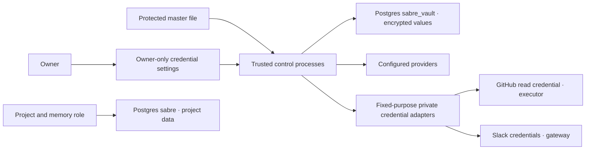

# Credential storage decision

Status: accepted. Owner decision: 2026-11-05.

## Decision

Provider, repository, Slack and external-tool credentials move from environment variables into an encrypted control vault. It uses a separate `sabre_vault` database and role on the existing PostgreSQL instance. The project/memory role cannot connect to that database. This adds no independent database service.

AES-256-GCM from the maintained `cryptography` package encrypts values in the control process, with a random nonce and authenticated secret identifier/version. A protected 32-byte master-key file stays outside PostgreSQL. The owner selected automatic startup rather than a password prompt after every restart. Only API, work and control processes receive its read-only mount; project jobs, PostgreSQL, the executor and Slack gateway do not.

Encryption at rest does not remove key material from RAM during authentication. This boundary reduces accidental exposure through process environments, inspection, checkpoints, logs and context retrieval. It does not protect against an administrator controlling Docker or the trusted control process.

## Contracts and trust

- Owner APIs accept write-only `SecretStr` values. They return identifier, revision, configured state and update time. There is no read-value endpoint, model tool or MCP credential argument.
- Creation and replacement use revision checks. Deactivation stops future use in SABRE; it does not revoke the credential at its upstream provider.
- Model identifiers include the provider; local and MCP identifiers bind the endpoint digest. Changing a destination cannot silently reuse another destination's key.
- Bootstrap authentication and database access necessarily precede vault access. Small, service-specific protected files provide those credentials. Environment variables contain only non-sensitive configuration and file paths.
- The executor and Slack gateway authenticate fixed-purpose private adapters. Neither receives the master key, the vault database credential or model keys.
- Dependency errors are sanitized before nested LangGraph checkpoints can record exception messages. HTTP access logs are disabled in the shipped servers.

## Migration and recovery

Migration reads only SABRE's own existing configuration. It verifies protected bootstrap files and encrypted imports before atomically removing secret fields from the public configuration. It does not make a plaintext backup or touch interactive application credential homes.

Back up the encrypted vault database together with project/checkpoint data. Preserve the bootstrap/master material separately using an owner-controlled protected destination. A lost master key cannot be recovered from the encrypted database. Startup and writes fail closed for a missing, wrong or corrupt key; they never silently regenerate it over existing data.

## Required checks

Verify encryption/authentication and record binding, concurrent revision conflicts, disabled credentials, wrong-key refusal, project-role access denial, and plaintext absence from API responses, checkpoints, logs and container environment/configuration. Exercise migration, restart, credential update, backup/restore and the owner settings UI against real PostgreSQL and containers before live provider setup.

The storage and separation principles follow [OWASP secret management](https://cheatsheetseries.owasp.org/cheatsheets/Secrets_Management_Cheat_Sheet.html) and [OWASP cryptographic storage](https://cheatsheetseries.owasp.org/cheatsheets/Cryptographic_Storage_Cheat_Sheet.html). File-based service grants follow the boundary described in [Docker secret management](https://docs.docker.com/compose/how-tos/use-secrets/); SABRE's Windows helpers must accommodate its existing WSL filesystem without changing host settings.
