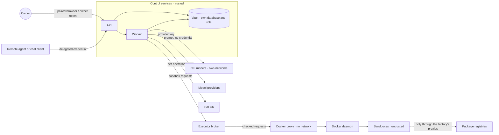

# Threat model

What the factory protects, who it protects it from, which control answers each threat and what is left undefended. It describes the deployment this repository ships: one owner, one host, Docker Compose. A control is listed only where code enforces it; where the evidence is a test or a runtime check, it is named. Section 6 lists what is not covered.

## 1. What is protected

| Asset | Why it matters |
| --- | --- |
| The owner's authority | Approving a delivery, a security exception, a budget or a repository creation. Whoever holds it decides what the factory does |
| Credentials | Model provider keys, GitHub tokens or the GitHub App's private key, MCP and Slack tokens, webhook signing keys, the vault master key |
| Source code and what is learned from it | The repositories under work, their snapshots, memory records, run evidence |
| The integrity of a delivery | That the branch and draft pull request contain exactly what was checked, reviewed and scanned |
| The host | The machine the factory runs on, its Docker daemon and its other data |
| Spend | Model usage charged to the owner |

## 2. Who is trusted, and with what

- **The owner and the host are trusted.** Anyone who can run commands on the host, read the bootstrap volumes or reach the Docker daemon controls the factory. Nothing here defends against that.
- **The control services** (API, worker and control) are trusted with the vault credential and the master key. A defect in them that an attacker can drive is a full compromise. The Slack gateway uses a fixed-purpose adapter and does not receive the vault credential or master key.
- **The executor broker** is trusted to describe sandboxes, and no further: it does not hold the Docker socket.
- **The CLI runners** hold a vendor session. They are trusted to turn a prompt into a structured reply and with nothing else.
- **Everything below is untrusted:** repository content, dependency code, tool output, MCP servers, remote agents, model output, memory content, and any process inside a sandbox.

## 3. Boundaries

The API is published on the loopback interface only. Every service runs with a read-only root filesystem, all capabilities dropped and `no-new-privileges`. The control network is internal; services that need the internet reach it through a separate network, and the two CLI runners each have their own pair of networks.

## 4. Threats and controls

### 4.1 Something other than the owner acts as the owner

*A page in the owner's browser, another container, a remote agent or a leaked link tries to approve, spend or deliver.*

- A browser is paired with a one-time ticket that expires in 60 seconds. The session is an HttpOnly, SameSite=Strict cookie scoped to the API path, with a per-session CSRF token and checks of Host, Origin and fetch metadata on every change.
- A sibling container reaches the same port and cannot obtain a session. The runtime check exercises this on the running stack (`sibling_panel_access: denied`).
- Remote agents never receive the owner credential. They hold a delegated credential stored as a hash, limited to named projects and operations, with an expiry and its own budget. A delegated answer can clarify; it cannot approve architecture, scope, an exception, a budget or publication.
- A high-impact request that arrives over MCP (budget, security exception, owner decision, repository creation) is only filed. It changes nothing until a paired browser confirms the request that is displayed, once.
- Connecting GitHub starts and ends in a paired browser: the owner token alone cannot start it, and the `state` is single-use and bound to the browser that began.

### 4.2 Hostile content steers the agents

*A repository, a dependency, a tool result, an MCP server or a memory record contains instructions.*

- Content is data. It grants no tool, no permission and no approval; the registered code validates plans, permissions, transitions, budgets and publication evidence.
- Each specialist has a fixed tool list. An MCP tool is available only when the owner reviewed the server and the tool, and a tool with an external effect needs its own authorization.
- What a steered agent can still do is bounded by those tools: read and write inside the run's workspace, run commands inside the run's sandbox, propose a memory record, ask the owner a question. It cannot reach a credential, another run, the host or GitHub.
- A memory record enters only as a proposal the owner approves, with its provenance and the commit it was true at.
- The result of the work is a branch and a draft pull request. The factory has no command that merges, deploys or releases without a separate owner authorization.

This bounds the damage; it does not prevent a steered agent from writing bad code that passes the checks. The independent review and security stages, and the owner's own review of the draft, are what stands between that and a merge.

### 4.3 Untrusted code runs

*Tests, build scripts and dependencies of the project execute during a run.*

- They run only in sandboxes the Docker proxy admits: digest-pinned images labelled as factory-owned, read-only root, all capabilities dropped, `no-new-privileges`, no host paths, devices, namespaces or published ports, mounting only that run's workspace volume and the scanner caches.
- A sandbox has no network by default. Dependency preparation reaches package registries through a proxy the factory controls, and the scanners' databases update through another.
- The broker cannot ask the daemon for anything else: the proxy holds the socket, has no network itself, forwards one request per connection and rewrites what it checked, so the daemon parses what the policy examined. A broker defect no longer reaches the API, the database or a credential volume.
- Sandboxes never receive a credential, the Docker socket or an owner directory. Work and gate environments are separate, and gates run against the approved snapshot.
- CPU, memory, process count, duration and output are bounded per command.

### 4.4 A credential leaks

*Through a prompt, a tool result, a log, a trace, an artifact or the database.*

- Credentials live in a vault with its own database and role; the project role cannot connect to it. Values are encrypted with authenticated encryption bound to the secret's identifier and version, are write-only through the API and never appear in OpenAPI models, MCP tools or agent state.
- Secret values are not passed in the environment: services read protected bootstrap files, and the runtime check counts zero credential fields in the environment.
- A secret guard checks material before it goes to a model, into memory, into an ordinary output or into the artifact store, against known factory secrets and documented token formats. GitHub tokens are recognised by prefix whatever their length.
- With the GitHub connection, each operation gets a token for one repository with only the permissions it declares, held in memory for at most an hour and never stored. The app's private key stays in the vault.
- Traces and operational logs pass an allowlist of identifiers, codes and counts. No prompt, response, code, command or output is exported, and no setting turns that on. The HTTP servers write no access log, so a query string cannot become one, and they write no request span either: the factory's tracer provider is not the process-wide one and the web framework's own telemetry is off in every application, so only the spans the factory writes are exported.
- Deactivating a credential removes its ciphertext. It does not revoke the upstream token, and the console says so.

### 4.5 The model or its provider misbehaves

*Wrong, unsafe or runaway output; a provider that fails or changes.*

- Every call reserves tokens and cost before it is sent and a run stops at its limits; a lost response keeps its reservation.
- Structured results are validated; a failed tool call the model can correct returns as a typed observation, and authorization, policy, secret and budget failures still stop the stage.
- A changed credential, connection or model configuration interrupts pending sends instead of switching a running agent silently.
- Deterministic checks, an independent review and an independent security stage (secret, code and dependency scanners) follow the work. A scanner that cannot complete blocks; it is never read as a clean scan.

### 4.6 The delivery is not what was reviewed

- Publication binds the branch and the commit to the snapshot, the gate results, the review and the security policy digest, and checks them again before every external effect.
- The base commit is verified before the branch moves, an existing branch or pull request must match the reviewed delivery exactly, and nothing is force-pushed.
- Each external effect has a durable receipt, so a lost response is reconciled instead of repeated.

### 4.7 The factory's own supply chain

- Runtime images are pinned by digest; Python and web dependencies are locked, and web dependencies must be at least seven days old.
- Scanner images are accepted only as digest-pinned references.

## 5. Evidence

| Control | Where it is checked |
| --- | --- |
| Another container cannot obtain a session | `infra/runtime-check.mjs` on the running stack |
| No credential in the environment; no secret in public configuration | `infra/runtime-check.mjs`, `infra/bootstrap-check.mjs` |
| The CLI runner's seccomp profile is the reviewed one | `infra/runtime-check.mjs` |
| A query string never reaches a log | `infra/runtime-check.mjs` (canary) |
| The Docker proxy admits only the sandbox profile | `backend/tests/test_docker_proxy.py` and the runtime smokes under `backend/tests/runtime_*_smoke.py` |
| On the deployed host, a sandbox command has no network, no Docker socket, no broker state and no credential; a gate runs against its snapshot; a restarted broker restores the workspace | `infra/runtime-check.mjs`, which runs `backend/tests/runtime_executor_smoke.py` inside the deployed executor, through its permission proxy |
| Session, CSRF, origin and delegation rules | backend unit and PostgreSQL integration tests |
| Secret guard formats and redaction | backend unit tests |
| Telemetry allowlist: nothing set is dropped, nothing private is exported | backend tests with a recording exporter |
| GitHub connection: state, code, installation, token scope | integration tests against a synthetic GitHub |

## 6. What is not defended

- **A kernel escape.** Sandboxes are hardened containers on a kernel shared with the control services. Current guidance for untrusted code is VM-level isolation. Run the factory on a machine or virtual machine that holds nothing else of value; a stronger runtime is not evaluated yet.
- **Egress denial between checks.** The runtime check proves, when it is run, that a command in a sandbox on this host cannot open an outbound connection and sees no socket, token or bootstrap file. Nothing watches it in between: a later change to the host's Docker configuration is found by the next check, not when it happens. The check opens one connection to one address; it is not a survey of every way out.
- **Content sent to model providers.** The source a specialist reads goes to the configured provider or CLI vendor. The secret guard stops known secrets and documented token formats; it cannot recognise arbitrary sensitive text.
- **A steered agent inside its tools.** Section 4.2 bounds it and does not prevent it.
- **The host, the Docker daemon and the owner.** All three are trusted. There is one owner and no second role.
- **Availability.** A hostile repository can exhaust a run's budget or time; limits stop the run, they do not make it finish.
- **Upstream revocation.** The factory cannot revoke a token at GitHub, a provider or Slack; it can only forget it.
- **The local trace viewer.** When started, it listens on the loopback interface and, because Docker publishes ports only from a network with a route out, it can also reach the internet. It holds payload-free spans in memory.
- **Evidence from real runs.** Several controls above have been exercised only with scripted models and synthetic services, and only on Windows with Docker Desktop. The GitHub connection has not met github.com.
